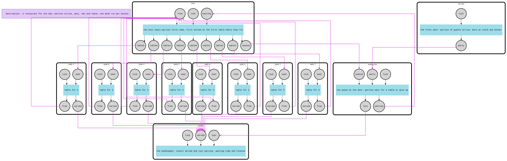

# Restaurant

This example simulates one day in a restaurant as an F-Mesh and prints the bookkeeper's report for that day. Change a number, or swap the host for a smarter one, and run it again to see what the owner's choices are worth. It was written for the ESM 2026 tutorial on F-Mesh, for an audience of engineers and non-programmers alike, so the code is meant to read like prose.

The scenario: parties of one to six guests arrive at the door, more of them around lunch and dinner. A host seats them at the tables that are free; a party that waits more than 20 minutes gives up and leaves. Every seated party eats for 45 to 90 minutes, pays 25 EUR per guest and goes. A bookkeeper counts served and lost parties, waiting time, table utilisation and revenue.

Time is discrete: **one mesh run is one simulated minute**. A run loop puts the current minute on the `tick` input of every component and calls `fm.Run(ctx)`, 720 times for a day from 11:00 to 23:00. Components keep their state between runs, so the day builds up minute by minute.

## How it works

| Component | Inputs | Outputs | State | Behaviour |
|-----------|--------|---------|-------|-----------|
| `arrivals` | `tick` | `party` | seeded random generator, next ID | Each minute decides how many parties walk in (two draws against a rate that peaks at lunch and dinner), gives each a size (couples are the most common) and a meal duration, and emits one `Party` per arrival. |
| `waiting-list` | `party`, `seated`, `tick` | `waiting`, `lost` | the queue, in arrival order | New parties join the queue, seated ones leave it. On every tick parties past their patience go out on `lost`; then the whole queue goes out on `waiting`, one signal per party, for the host to choose from. |
| `host` | `waiting`, `free`, `tick` | `seated`, `table0` ... `table<n-1>` | free tables (index -> seats) | Learns which tables are free from their announcements. When the waiting list arrives it seats parties according to its policy: a `Seating` goes to the matching indexed `table<i>` output and the party goes back on `seated`. Two hosts share this code and differ only in the policy function: **FIFO** (`newFIFOHost`) walks the parties in arrival order and gives each the first free table where it fits; **best fit** (`newBestFitHost`) walks the free tables from small to large and gives each the party that leaves the fewest empty seats, so big tables are kept for big parties. |
| `table-<i>` | `seat`, `tick` | `free`, `served` | seats, seated party, minutes left | One constructor for every size (`newTable(index, seats)`; the seats are also component metadata). Announces `TableFree` on the first tick and after every visit. On `seat` it stores the party; each tick counts the meal down and, when it is over, emits a `Served` record (party, seats, minutes waited, time left) and announces itself free again. |
| `report` | `served`, `lost`, `tick` | — | the `Report` so far | Adds up parties and guests served and lost, waiting minutes, busy table-minutes and minutes open. `readReport(fm)` takes the `Report` out after the day; its `String()` prints the summary. |

The wiring (`mesh.go`):

```
arrivals.party        -> waiting-list.party
waiting-list.waiting  -> host.waiting
waiting-list.lost     -> report.lost
host.seated           -> waiting-list.seated
host.table<i>         -> table-<i>.seat        (for every table)
table-<i>.free        -> host.free
table-<i>.served      -> report.served
```



### How a minute works

One run is a few activation cycles. In the first cycle every component with a tick activates: a table whose party has finished emits `served` and `free`, the waiting list drops impatient parties and emits the queue, the arrivals may emit a new party. In the second cycle the host receives the queue and the free tables and seats whom it can; the report receives the served and lost parties; the waiting list receives the new arrivals. In the third cycle the tables receive their seatings and the waiting list forgets the seated parties. Nothing is left to deliver, so the run stops and the next minute begins.

### What-if

`main.go` runs one day and prints the report. The simulation does not know about alternatives: to ask a what-if question you change the restaurant in `mesh.go` and run the day again. The seed is fixed, so the same guests arrive at the same minutes in every run and the reports are comparable.

```
  Host policy    : fifo
  Tables         :    8
  Parties served :   40  (106 guests)
  Parties lost   :    9  (40 guests)
  Average wait   :    4.5 min
  Utilisation    :   48.3 %
  Revenue        : 2650 EUR
  Lost revenue   : 1000 EUR
```

- **A smarter host.** In `newRestaurant`, replace `newFIFOHost` with `newBestFitHost`. The two hosts have the same ports, so nothing else changes: 41 parties served instead of 40, 2775 EUR instead of 2650.
- **More tables.** Append to `tableSeats`; two extra 4-tops serve 44 parties and earn 3050 EUR under the FIFO host.
- **Anything else.** The constants at the top of `mesh.go` (patience, opening hours, revenue per guest, seed) and the arrival rates in `arrivals.go` are there to be edited.

Notable APIs: `component.WithIndexedOutputs` for the host's one-port-per-table, `component.WithInitialState` / `this.State()` for per-component state, `component.WithMeta` for the table size and the host's policy name, `port.MultiPipe` for wiring, `sig.As[T]()` and `Signals().FirstAs[T]()` for typed payloads, and `fmesh.WithErrorHandlingStrategy(fmesh.StopOnFirstErrorOrPanic)` on the mesh.

## Run

```bash
go run .

# Regenerate restaurant-graph.dot / .svg
FMESH_GRAPH=1 go run .

# Tests, one file per component plus a whole-day test
go test -race .
```
